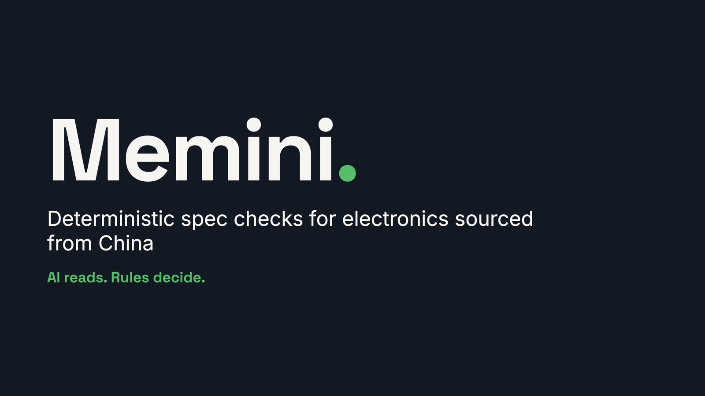
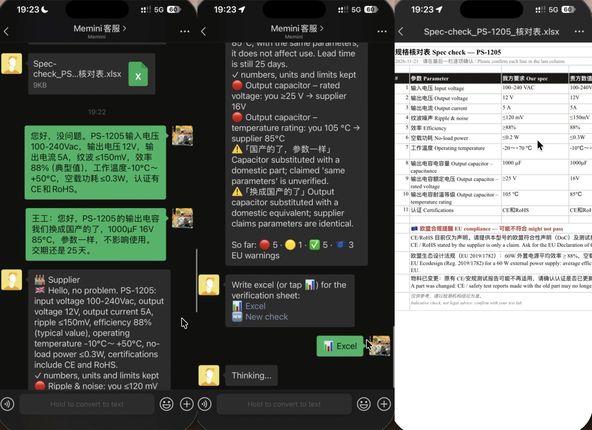
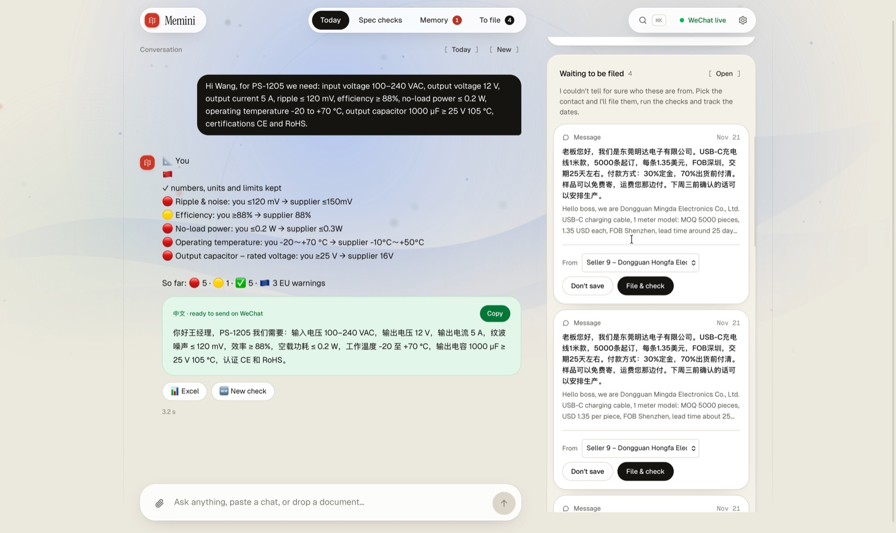
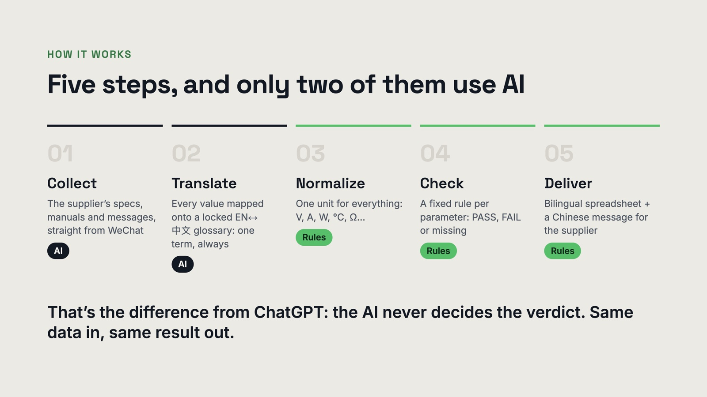
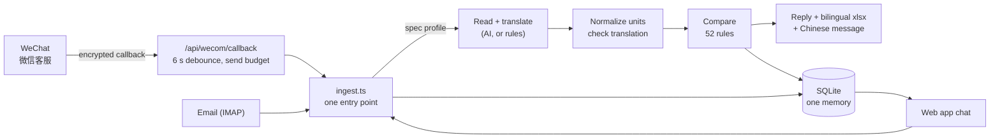

<p align="center">
  
</p>

<p align="center">
  <b>A WeChat assistant that checks a Chinese supplier's specs against yours,<br>and tells both of you exactly what doesn't match.</b>
</p>

<p align="center">
  🏆 <b>Hackathon winner</b> · built in 12 hours · November 2026 &nbsp;·&nbsp;
  <a href="docs/memini-pitch-deck.pdf">Pitch deck (PDF)</a> &nbsp;·&nbsp;
  <a href="#run-it-locally">Run it locally</a>
</p>

---

> [!NOTE]
> **Status: hackathon project, no longer deployed.** The AI API keys we used during the event have expired and the demo
> server is offline. Everything still runs locally **without any key**: rule-based readers and saved answers stand in
> for the AI, and all 133 tests pass offline. To turn on live AI, add your own Anthropic key ([below](#live-ai)).

## The problem

Finding a supplier in China is solved: Alibaba, 1688 and Global Sources do it well. The hard part starts after.
A small EU company importing electronics gets datasheets, test reports and WeChat messages **in Chinese, with their own
terms and units**, and has to make sure they match its own specification before it pays a deposit and puts its brand
(and its CE mark) on the product.

- Electrical appliances are among the most-flagged dangerous products in the EU, and most alerts concern products from China.
- Many CE failures are **documentation** failures, not hardware ones.
- General-purpose AI translates well, but it still slips on numbers, limits and units, and in electronics one wrong
  number means a recall. A CE consultant plus a translation agency costs thousands of euros per product.

## What Memini does

You forward the supplier's messages, datasheets and photos to the **Memini** chat on WeChat, the app where you already
talk to suppliers. Nothing to install.

<p align="center">
  
</p>

1. **Forward** your spec and whatever the supplier sends (chat messages, PDF datasheets, photos).
2. **Translate**: every technical line between **your language** and Chinese, through a locked glossary. One term, always the same.
3. **Check**: every parameter against your spec. 🔴 mismatch · 🟡 to confirm · ⚠️ not stated · ✅ OK. Swapped
   parts ("我们换成国产的了，参数一样": *we switched to a domestic part, same parameters*) are flagged.
4. **Reply**: write `excel` and you get a bilingual `.xlsx` verification sheet (your language + 中文) plus a Chinese
   message for the supplier, ready to forward. The supplier fills in and confirms each line.

The same memory is in the web app: everything you forward on WeChat shows up there, and the web chat works the same way.

### Your language ⇄ 中文

You pick your language once on the web app (the chip on **Today**, or **Settings**), and the WeChat bot follows it.
The supplier always gets Chinese.

| | Translations | Bot messages, parameter names, verification sheet |
|---|---|---|
| English, Italiano, Deutsch, Français, Español | ✅ | ✅ in your language: the locked glossary has all 52 parameters in each |
| Português, Nederlands, Polski, Svenska, Čeština, Română, Türkçe, Русский, 日本語, 한국어, Tiếng Việt | ✅ by the AI | English |

Limit words are checked in every full language: a translation that turns 不低于 ("at least") into *höchstens* or
*al massimo* is flagged.

<p align="center">
  
</p>

## AI reads. Rules decide.

<p align="center">
  
</p>

The AI is only trusted to **read**: classify what was forwarded, translate it and list the values it contains, each
with the exact quote it came from. Everything that decides is plain, tested code:

| Step | How | Where |
|---|---|---|
| Read + translate | One model call per item (PDF, photo or chat), with the locked glossary in the user's language in the prompt. Without a model: a rule reader (glossary + unit parser) | [`lib/core/spec/extract.ts`](lib/core/spec/extract.ts) |
| Translation check | Every number, unit, limit sign (≥ ≤ ~ ±) and part number in the original must survive in the translation, or the line is flagged | [`lib/core/spec/quantity.ts`](lib/core/spec/quantity.ts) |
| Normalize | `150mVp-p`, `0.15 V`, `1000UF`, `16伏`, `-10℃～+50℃` → SI values and ranges | [`lib/core/spec/quantity.ts`](lib/core/spec/quantity.ts) |
| Compare | 52 parameters, each with a fixed rule: `min`, `max`, `covers` (a range must cover yours), `includes` (sets such as certifications), `eq` | [`lib/core/spec/params.ts`](lib/core/spec/params.ts), [`compare.ts`](lib/core/spec/compare.ts) |
| EU warnings | Indicative, never a verdict: CE/RoHS stated in a chat is only a claim (ask for the DoC), EU Ecodesign 2019/1782 limits for external power supplies, a part changed after certification | [`lib/core/spec/eu.ts`](lib/core/spec/eu.ts) |
| Deliver | Bilingual `.xlsx` (ExcelJS) and the Chinese message, both built from the table, not by a model, so the numbers can't drift | [`sheet.ts`](lib/core/spec/sheet.ts), [`flow.ts`](lib/core/spec/flow.ts) |

Same data in, same verdict out.

### The demo case: a 12 V power supply

The demo (`data/demo/spec`, PDFs and images in `public/demo/spec`) is a 60 W power supply, part **PS-1205**: the
buyer's English requirements, the supplier's Chinese datasheet (规格书), and a WeChat message a day later where the
supplier quietly swaps the output capacitor:

| Parameter / 参数 | Ours | Supplier | Result |
|---|---|---|---|
| Output voltage 输出电压 | 12 V | 12V | ✅ |
| Ripple & noise 纹波噪声 | ≤ 120 mV | ≤150mV | 🔴 |
| Efficiency 效率 | ≥ 88 % | 88%（典型值, *typical*） | 🟡 typical only |
| Operating temperature 工作温度 | −20 … +70 °C | −10℃～+50℃ | 🔴 doesn't cover |
| Output capacitor, rated voltage 输出电容额定电压 | ≥ 25 V | 16V (was 25V) | 🔴 changed after the datasheet |
| Certifications 认证 | CE, RoHS | CE、RoHS | ✅ + 🇪🇺 ask for the Declaration of Conformity |

## Run it locally

Requires **Node.js 22**. No API key, no WeChat account needed.

```bash
git clone https://github.com/nicolosibona/memini.git
cd memini
npm install
cp .env.example .env.local      # LLM_PROVIDER=mock, MEMINI_PROFILE=electronics
npm run dev                     # http://localhost:3000
```

Then, on the **Today** page, paste the buyer's requirements and the supplier's reply into the chat (or drop the PDFs
from `public/demo/spec`), and write `excel`. For example:

```text
Hi Wang, for PS-1205 we need: ripple ≤ 120 mV, efficiency ≥ 88%, operating temperature -20 to +70 °C, certifications CE and RoHS.
```
```text
您好，没问题。PS-1205纹波≤150mV，效率88%（典型值），工作温度-10℃～+50℃，认证有CE和RoHS。
```

**Spec checks** lists every check with its table and sheet. **Settings** switches the workspace profile and resets the demo data.

```bash
npm test             # 133 unit + end-to-end tests, offline, no AI
npm run lint
npm run build
```

### Live AI

Set `LLM_PROVIDER=anthropic` and `ANTHROPIC_API_KEY` in `.env.local` (or `gateway` for an Anthropic- or
OpenAI-compatible gateway, or `qwen` for Alibaba DashScope, which is reachable from mainland China). Each pipeline
step has its own model (`MODEL_SPEC`, `MODEL_SPEC_CHAT`, `MODEL_ASSISTANT`, …), so changing models is configuration.

`npm run test:live` runs the real model against the demo documents and golden answers, and prints latency and cost per
step. If a call fails or times out, that step falls back to the rules, so the bot never dead-ends; a rejected key
(401/403) switches the app to rules for 10 minutes instead of failing every message, and `/api/health` says so.

### WeChat

The bot runs on **微信客服 (WeChat Customer Service)** through a WeCom (企业微信) account: users scan a QR code with
their personal WeChat. Setting up your own account and server takes about an hour: see
**[docs/wechat-setup.md](docs/wechat-setup.md)**, which also lists what we learned about the WeChat API (the
5-message send budget, burst grouping, menus, file upload).

## Architecture



- **Next.js 15** (App Router) + **React 19** + **Tailwind 4**, TypeScript throughout.
- **SQLite** (better-sqlite3) with full-text search; schema changes are additive migrations.
- **Claude** through `@anthropic-ai/sdk`; every model answer is validated with **Zod** schemas.
- **WeCom** crypto (AES + signature) implemented and unit-tested in [`lib/channels/wecomCrypto.ts`](lib/channels/wecomCrypto.ts).
- **ExcelJS** for the verification sheet, **pm2 + Caddy** on a single VPS ([`scripts/deploy.sh`](scripts/deploy.sh)).

| Path | What |
|---|---|
| `lib/core/spec/` | the electronics spec check: reading, glossary, units, rules, EU warnings, the sheet |
| `lib/core/` | the shared memory and pipeline: ingest, contacts, matters, facts, deadlines, audit, assistant, replies |
| `lib/channels/` | WeChat (WeCom crypto, `sync_msg`, media, menus, send budget), email (IMAP) |
| `lib/adapters/` | the only files that know the AI provider (LLM, speech-to-text), plus a company registry |
| `app/` | the web app (Today, Spec checks, Memory, To file, WeChat, Settings) and the API routes |
| `data/demo/` | demo documents and a fictional company registry |
| `tests/` | unit and end-to-end tests (`npm test`), live AI suite (`npm run test:live`) |

## Beyond spec checks

Memini started as a broader "memory" for foreigners doing business in China, and that engine is still in the code,
behind the `sourcing` and `china_business` workspace profiles (Settings → Profile):

- **Contacts, matters, documents, facts, deadlines.** Anything forwarded is read into who it's from, which case it
  belongs to (a purchase, a lease, a residence permit, a tax filing), the facts it states with their source quote, and
  every date. Who sent it is only taken as certain from a license, contract or notice; otherwise the bot asks.
- **Deterministic audits**: document vs. chat (price, Incoterm, rent…), payee ≠ company, personal bank accounts,
  expiring documents, missing paperwork.
- **Supplier confirmation links** (a Chinese-first page where the supplier confirms the terms, stored as an immutable
  snapshot), **iPhone calendar feed**, **Email to Memini**, copy-ready Chinese replies, and RFQ outreach to several
  factories at once.

The original design documents are in [`docs/history/`](docs/history/).

## Limitations

- **Single workspace, no login.** The app runs one demo workspace and user; it is not meant to be exposed to
  untrusted users as is.
- **EU checks are indicative**, never legal advice: they tell you what to ask the supplier and your test lab.
- The rule reader (no AI) handles the demo documents and clean chat messages; real-world PDFs and photos need a model.
- WeChat Customer Service caps how many messages the bot can send per user message; long checks wait for the next message.

## Roadmap

From the pitch: **spec check in WeChat** (built) → **EU Cyber Resilience Act** checks ahead of 2027 → a **living EU
technical file** per product, kept up to date from what suppliers send.

## Team

Built in **12 hours** at a hackathon in November 2026 by **Nicolò Sibona**, **Alessandro Giostra**, **Uros Bikic** and **Marco Maiorino**.
